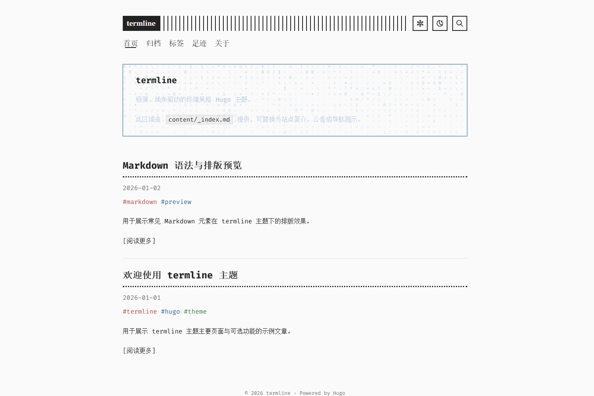

# hugo-theme-termline

[English](README.md) | [简体中文](README.zh-CN.md)

A minimal, line-driven terminal theme for [Hugo](https://gohugo.io/).



## Overview

This repository is a Hugo project for developing, previewing, and verifying
the `termline` theme. The project root provides generic demonstration content
and project-level overrides, while the distributable theme lives in
`themes/termline/`. It contains no real blog content or personal site data.

```text
main
├─ hugo.toml + content/       → project configuration and generic demo content
├─ layouts/ + assets/         → project-level override examples
└─ themes/termline/           → complete distributable theme
                               ↓
theme branch                  → installable theme at repository root
```

For installation and configuration, see the
[theme documentation](themes/termline/README.md).

## Highlights

- Responsive terminal-inspired layout with light and dark color schemes
- English and Simplified Chinese interface strings
- Client-side search, archives, tags, covers, and pagination
- About and journeys page templates
- Markdown alerts, syntax highlighting, Mermaid diagrams, and image lightbox
- Project-level CSS, JavaScript, and template hook overrides

## Requirements

- Hugo Extended `0.163.3` or newer
- PowerShell 7 is recommended for the repository scripts

## Local Development

Start the development server from the repository root:

```powershell
./scripts/dev.ps1
```

The generic demonstration content under `content/` exists only to exercise the
theme. Personal content and configuration should stay in the consuming Hugo
project.

## Repository Structure

| Path | Purpose |
| --- | --- |
| `content/` | Generic demonstration pages and posts used to exercise the theme |
| `assets/custom/` | Project-level CSS and JavaScript override examples |
| `layouts/partials/hooks/` | Project-level template hook examples |
| `themes/termline/` | Complete theme and the source of the `theme` branch |
| `scripts/dev.ps1` | Local development server |
| `scripts/verify-theme.ps1` | Full structure, privacy, override, asset, and build verification |

## Override Contract

Hugo gives project files precedence over theme files. This repository keeps the
supported override locations visible at the project root:

- `assets/custom/custom.css`
- `assets/custom/custom.js`
- `layouts/partials/hooks/*.html`

See [Customization and Hooks](themes/termline/README.md#customization-and-hooks)
for the complete list of hook slots.

## Distribution

The `main` branch is the development repository. The publish workflow exports
`themes/termline/` to the `theme` branch, where the theme files live directly at
the repository root. A Hugo site can then install that branch with:

```bash
git submodule add -b theme https://github.com/wobushi041/hugo-theme-termline.git themes/termline
```

Before publishing a release or tag, run the full verification:

```powershell
./scripts/verify-theme.ps1
```

## Contributing

Issues and pull requests are welcome. Keep demonstration content generic and
anonymous, and place theme runtime changes under `themes/termline/`; use the
project root only for development configuration and override examples.

## License and Attribution

`termline` is released under the [MIT License](LICENSE). It is derived in part
from [Terminal](https://github.com/panr/hugo-theme-terminal) by panr. Bundled
third-party components and their licenses are listed in
[THIRD_PARTY_NOTICES.md](themes/termline/THIRD_PARTY_NOTICES.md).
