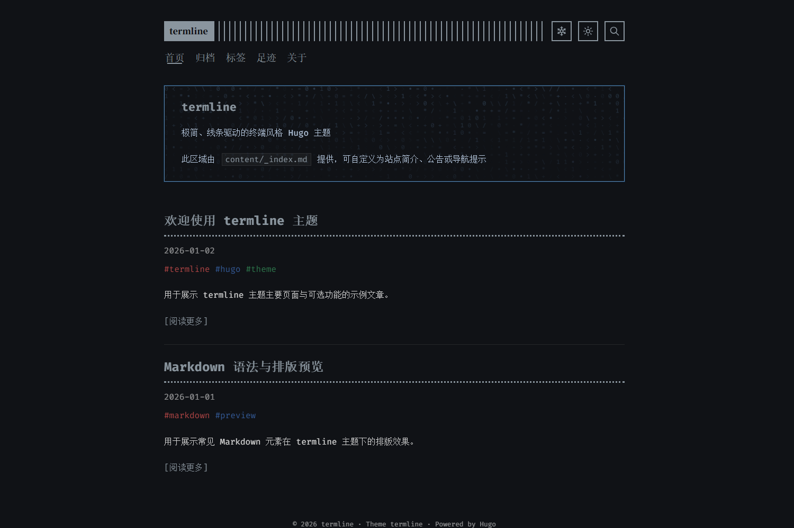

# termline

[English](README.md) | [简体中文](README.zh-CN.md)

一个极简、线条驱动的终端风格 [Hugo](https://gohugo.io/) 主题。

<p align="center">
  
  
</p>

## 主要特性

- 响应式终端风格布局，支持浅色与深色配色
- 英文和简体中文界面文本
- 基于 Hugo 首页 JSON 输出的客户端搜索
- 归档、标签、文章封面、分页和阅读信息
- 独立的关于页和足迹页模板
- Markdown 警告块、代码高亮、Mermaid 图表与图片灯箱
- 项目级 CSS、JavaScript 和模板插槽覆盖

## 如何使用

请根据目标选择对应方式：

- 想快速体验完整示例站点，请克隆 `main` 分支。
- 想在自己的 Hugo 站点中使用主题，请安装 `theme` 分支。

### 1. 准备环境

- [Git](https://git-scm.com/)
- Hugo Extended `0.163.3` 或更高版本
- 建议使用 PowerShell 7 运行仓库脚本

安装完成后，可以检查 Hugo 版本：

```powershell
hugo version
```

### 2. 快速预览完整仓库

`main` 分支包含通用演示内容、开发配置和快速启动脚本：

```powershell
git clone --branch main https://github.com/wobushi041/hugo-theme-termline.git
Set-Location .\hugo-theme-termline
.\scripts\dev.ps1
```

脚本默认从 `http://127.0.0.1:1313/` 启动。如果该端口已被占用，会自动选择后续
可用端口。也可以手动指定起始端口：

```powershell
.\scripts\dev.ps1 -Port 1414
```

`scripts/dev.ps1` 仅存在于 `main` 分支；`theme` 分支只包含可安装的主题文件。

### 3. 安装到现有 Hugo 站点

#### Git submodule

可发布主题位于 `theme` 分支，该分支以主题文件作为仓库根目录：

```bash
git submodule add -b theme https://github.com/wobushi041/hugo-theme-termline.git themes/termline
```

后续更新主题：

```bash
git submodule update --remote --merge themes/termline
```

#### 手动安装

下载 `theme` 分支或 Release 压缩包，将其解压到 Hugo 站点的
`themes/termline/` 目录。

### 4. 配置站点

在站点的 `hugo.toml` 中启用主题和搜索所需的 JSON 索引：

```toml
baseURL = "https://example.org/"
title = "示例站点"
theme = "termline"
defaultContentLanguage = "zh-cn"

[outputs]
home = ["HTML", "RSS", "JSON"]

[params]
contentTypeName = "posts"
showMenuItems = 6
fullWidthTheme = false
centerTheme = true
autoCover = true
showLastUpdated = false

[languages]
[languages.zh-cn]
label = "简体中文"
weight = 1

[languages.zh-cn.params]
subtitle = "一个极简的终端风格博客"

[languages.zh-cn.params.logo]
logoText = "termline"
logoHomeLink = "/"
```

### 5. 创建文章并启动 Hugo

```bash
hugo new content posts/hello.md
hugo server
```

打开终端输出中的本地地址即可预览。如果文章仍为草稿，可以使用：

```bash
hugo server --buildDrafts
```

### 6. 生成静态站点

```bash
hugo
```

生成结果位于 `public/`，可以部署到任意静态网站托管平台。

## 配置

### 页脚

```toml
[params.termline.footer]
showPoweredBy = true
owner = "示例作者"
```

当 `showPoweredBy = true` 时，页脚会在版权信息后显示 `Theme termline` 和
`Powered by Hugo`；设为 `false` 后仅显示版权。站点级 `copyright` 配置会完整
替换自动生成的页脚。

### 站点资源

对应值留空时不会输出该资源：

```toml
[params.termline.assets]
favicon = "/favicon.ico"
faviconSvg = "/favicon.svg"
appleTouchIcon = "/apple-touch-icon.png"
defaultOgImage = "/og-image.png"
```

### ICP 与公安备案

以下字段供需要中国大陆备案链接的站点选用：

```toml
[params.termline.beian]
icpNumber = ""
icpURL = "https://beian.miit.gov.cn/"
policeNumber = ""
policeURL = ""
policeIcon = ""
```

## 页面模板

### 关于页

创建 `content/about.md`：

```toml
+++
title = "关于"
type = "about"
profileName = "示例作者"
motto = "一个极简的终端风格博客。"
mottos = ["一个极简的终端风格博客。", "保持专注，持续记录。"]
avatar = "/images/avatar.svg"
heroBackground = "/images/banner.jpg"
+++
```

主题在 `static/images/avatar.svg` 提供了中性头像模板。在 Hugo 项目的相同路径
放置自己的文件即可覆盖它。

### 归档页

创建 `content/archives.md`：

```toml
+++
title = "归档"
type = "archives"
+++
```

### 足迹页

创建 `content/journeys.md`：

```toml
+++
title = "足迹"
type = "journeys"
homeCity = ""
startDate = ""
provinces = []
spots = []
cityCoordinates = {}
+++
```

## 自定义与模板插槽

Hugo 会优先使用项目中的同路径文件，因此自定义内容可以保留在主题之外，
升级主题时无需修改主题源码。

### CSS 与 JavaScript

在 Hugo 项目根目录创建以下文件：

- `assets/custom/custom.css`：在主题样式之后加载
- `assets/custom/custom.js`：在主题脚本之后加载

### 模板插槽

在 Hugo 项目的 `layouts/partials/hooks/` 下创建同名文件即可覆盖插槽：

| 插槽 | 插入位置 |
| --- | --- |
| `head-end.html` | `<head>` 末尾 |
| `body-start.html` | `<body>` 开始处 |
| `header-after.html` | 站点页头之后 |
| `content-before.html` | 主内容块之前 |
| `content-after.html` | 主内容块之后 |
| `footer-before.html` | 站点页脚之前 |
| `body-end.html` | `<body>` 末尾 |

## 支持与贡献

请通过仓库 Issue 反馈缺陷或提出功能建议。欢迎提交 Pull Request；修改主题后，
请先运行仓库提供的完整检查脚本。

## 许可证与署名

`termline` 使用 [MIT License](LICENSE) 开源。部分代码源自 panr 的
[Terminal](https://github.com/panr/hugo-theme-terminal)。随主题分发的第三方组件
及其许可证见 [THIRD_PARTY_NOTICES.md](THIRD_PARTY_NOTICES.md)。
