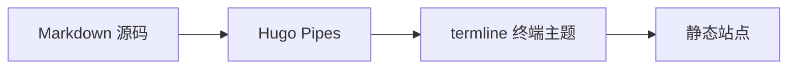

+++
title = "欢迎使用 termline 主题"
date = "2026-01-01T00:00:00Z"
tags = ["termline", "hugo", "theme"]
categories = ["Guide"]
description = "用于展示 termline 主题主要页面与可选功能的示例文章。"
+++

**termline** 是一款终端风格、线条驱动的 Hugo 主题。本页用于集中展示主题功能。

## 特性概览

- **前端资源**：主题样式与交互使用原生 CSS 和 JavaScript。
- **视觉语言**：包含点阵字符 Hero、等宽字体与线条边框。
- **配色模式**：提供深色与浅色显示模式。
- **地图页面**：提供可选的 SVG 地图、状态标记与内容筛选组件。
- **站内搜索**：使用 Hugo 生成的 JSON 索引进行前端检索。
- **内容扩展**：支持图片灯箱、Mermaid 流程图和 GFM 提示卡片。

## 代码示例

```go
package main

import "fmt"

func main() {
    fmt.Println("Hello, termline!")
}
```

> [!NOTE]
> 这是基于 GitHub Flavored Markdown (GFM) Alerts 的提示框卡片渲染展示。


