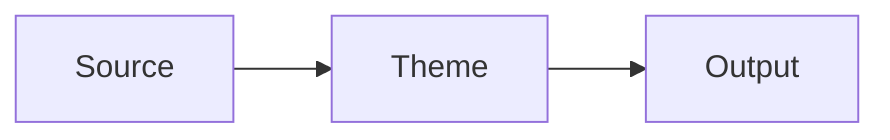

# termline Hugo Theme Extraction Implementation Plan

> **For agentic workers:** REQUIRED SUB-SKILL: Use superpowers:subagent-driven-development (recommended) or superpowers:executing-plans to implement this plan task-by-task. Steps use checkbox (`- [ ]`) syntax for tracking.

**Goal:** 将当前博客副本转换为根目录可开发、`themes/termline/` 可独立发布、包含中性示例但无真实文章和个人站点数据的 Hugo 主题仓库。

**Architecture:** 实施阶段只处理三个完整模块：主题运行时迁移、通用化与覆盖 API、开源发布与验证基础设施。每个模块的生产者、消费者和配置在同一 Task 内一次完成，不创建临时空骨架，不按单文件拆分迁移，也不在模块之间运行 Hugo 或测试脚本；所有自动化检查集中到最后一个 Task，由唯一入口 `scripts/verify-theme.ps1` 完成结构、隐私、覆盖契约、发布文件和匿名站点构建体检。

**Tech Stack:** Hugo `0.163.3`、Go templates、Hugo Pipes、HTML/CSS/JavaScript、PowerShell 7、GitHub Actions

**Spec:** `docs/superpowers/specs/2026-10-16-hugo-theme-extraction-design.md`

## Global Constraints

- 对外展示名和 Hugo 主题 slug 固定为 `termline`，发布单元固定为 `themes/termline/`，Git 仓库名使用 `hugo-theme-termline`。
- 不创建 `exampleSite/`；允许提交中性 `content/` 示例，但不得包含真实文章、人物、账号、地点轨迹或个人站点数据。最终体检仍在系统临时目录生成独立匿名 fixture。
- Task 1–3 不运行 Hugo、不运行测试脚本、不创建阶段性 `assert-theme-*` 脚本；Task 4 是唯一验证阶段。
- `archetypes/`、`assets/`、`layouts/`、`static/` 作为一个完整运行时模块迁移；任何一个目录无法整体移动时，停止当前 Task，不继续后续改造。
- 模块内的配置提供方、模板消费者、默认资源和覆盖入口必须在同一 Task 完成；不得提交缺失 partial、缺失资源或只改一半参数名的状态。
- 将当前 `content/` 替换为中性展示内容；删除 `raw/`、旧足迹设计文档、地图生成脚本及个人部署配置。
- 根目录只保留 `assets/custom/` 与 `layouts/partials/hooks/` 作为 Hugo 原生覆盖层，不保留完整主题模板副本。
- 运行时文件和中性示例不得包含私人邮箱、个人域名、备案号码、真实地点轨迹或其他个人站点数据；验证规则只保存通用模式，不保存被清理的私人值。
- 保留 Terminal 原作者 panr 的 MIT 版权声明和派生来源。
- Hugo 最低版本固定为 `0.163.3`。
- `public/`、`resources/`、`.hugo_build.lock` 和 IDE 文件不得进入版本控制。
- Task 1–3 只允许用 `git status --short`、`git diff --cached --name-status` 和迁移清单比对确认模块边界；这些不是功能测试，不替代 Task 4 的最终体检。
- 最终体检失败时，回到所属完整模块修复，然后重新运行整个 `scripts/verify-theme.ps1`；不得为失败点补建阶段性测试脚本。

---

### Task 1: 原子迁移完整主题运行时

**Files:**
- Move: `archetypes/` → `themes/termline/archetypes/`
- Move: `assets/` → `themes/termline/assets/`
- Move: `layouts/` → `themes/termline/layouts/`
- Move: `static/` → `themes/termline/static/`
- Create: `themes/termline/hugo.toml`
- Create: `themes/termline/theme.toml`
- Replace: `hugo.toml`
- Modify: `.gitignore`
- Replace: `content/` with neutral reusable examples
- Delete: `raw/`
- Delete: `docs/superpowers/specs/2026-09-06-china-map-footprints-design.md`
- Delete: `docs/superpowers/plans/2026-09-06-china-map-footprints.md`
- Delete: `scripts/generate_china_map_svg.py`
- Delete: `scripts/generate_china_cities_map_svg.py`
- Delete: personal assets listed in Step 4

**Interfaces:**
- Consumes: 当前根目录中的四个完整 Hugo 运行时目录。
- Produces: 完整且唯一的 `themes/termline/` 运行时、根开发配置和主题元数据。
- Atomic boundary: Step 2–5 连续完成；四个目录迁移前后清单不一致时立即停止，不进入 Task 2。

- [ ] **Step 1: 做只读前置检查并拒绝覆盖已有主题**

```powershell
$sourceModules = @("archetypes", "assets", "layouts", "static")
foreach ($module in $sourceModules) {
  if (-not (Test-Path -LiteralPath (Join-Path (Get-Location) $module))) {
    throw "Missing source module: $module"
  }
}

if (Test-Path -LiteralPath .\themes/termline) {
  throw "Refusing to overwrite existing themes/termline"
}

git status --short
```

该步骤只确认迁移前提，不修改文件，不执行构建。

- [ ] **Step 2: 捕获清单并整体移动四个运行时目录**

在同一个 PowerShell 会话执行：

```powershell
$repoRoot = (Resolve-Path .).Path
$sourceModules = @("archetypes", "assets", "layouts", "static")

$before = foreach ($module in $sourceModules) {
  $moduleRoot = Join-Path $repoRoot $module
  Get-ChildItem -LiteralPath $moduleRoot -Recurse -File | ForEach-Object {
    "$module/" + [System.IO.Path]::GetRelativePath($moduleRoot, $_.FullName).Replace('\', '/')
  }
}

New-Item -ItemType Directory -Path .\themes/termline -Force | Out-Null
git mv archetypes themes/termline/archetypes
git mv assets themes/termline/assets
git mv layouts themes/termline/layouts
git mv static themes/termline/static

$themeRoot = Join-Path $repoRoot "themes/termline"
$after = foreach ($module in $sourceModules) {
  $moduleRoot = Join-Path $themeRoot $module
  Get-ChildItem -LiteralPath $moduleRoot -Recurse -File | ForEach-Object {
    "$module/" + [System.IO.Path]::GetRelativePath($moduleRoot, $_.FullName).Replace('\', '/')
  }
}

$difference = Compare-Object ($before | Sort-Object) ($after | Sort-Object)
if ($difference) {
  $difference | Format-Table | Out-String | Write-Host
  throw "Runtime module inventory changed during relocation"
}
```

清单比对只证明整目录迁移没有漏文件，不判断主题功能是否正确。

- [ ] **Step 3: 一次写完根开发配置和主题配置**

根 `hugo.toml` 使用中性配置：

```toml
baseURL = "https://example.org/"
title = "termline Development"
theme = "termline"
defaultContentLanguage = "en"
pagination.pagerSize = 10

[outputs]
home = ["HTML", "RSS", "JSON"]

[markup.highlight]
noClasses = true
lineNos = true
lineNumbersInTable = false

[markup.goldmark.renderer]
unsafe = true

[params]
contentTypeName = "posts"
showMenuItems = 6
fullWidthTheme = false
centerTheme = true
autoCover = true
showLastUpdated = false

[languages]
[languages.en]
languageName = "English"
weight = 1

[languages.en.params]
subtitle = "A minimal terminal theme for Hugo"
menuMore = "More"
mobileMenuLabel = "Menu"
readMore = "Read more"
newerPosts = "Newer posts"
olderPosts = "Older posts"
missingContentMessage = "Page not found"
missingBackButtonLabel = "Back to home"
minuteReadingTime = "min read"
words = "words"

[languages.en.params.logo]
logoText = "termline"
logoHomeLink = "/"
```

`themes/termline/hugo.toml` 定义主题默认参数和版本下限：

```toml
[params]
contentTypeName = "posts"
showMenuItems = 6
fullWidthTheme = false
centerTheme = true
autoCover = true
showLastUpdated = false

[params.termline.footer]
showPoweredBy = true
owner = ""

[params.termline.assets]
favicon = ""
faviconSvg = ""
appleTouchIcon = ""
defaultOgImage = ""

[params.termline.beian]
icpNumber = ""
icpURL = "https://beian.miit.gov.cn/"
policeNumber = ""
policeURL = ""
policeIcon = ""

[module]
[module.hugoVersion]
min = "0.163.3"
extended = true
```

`themes/termline/theme.toml` 使用：

```toml
name = "termline"
license = "MIT"
licenselink = "https://github.com/wobushi041/hugo-theme-termline/blob/main/themes/termline/LICENSE"
description = "A minimal, line-driven terminal theme for Hugo."
homepage = "https://github.com/wobushi041/hugo-theme-termline"
tags = ["blog", "minimal", "terminal", "responsive", "dark-mode"]
features = ["responsive", "dark-mode", "search", "archives", "shortcodes"]
min_version = "0.163.3"

[author]
name = "wobushi041"
homepage = "https://github.com/wobushi041"

[original]
name = "Terminal"
homepage = "https://github.com/panr/hugo-theme-terminal"
repo = "https://github.com/panr/hugo-theme-terminal"
```

- [ ] **Step 4: 删除站点内容、旧专项资料和个人静态资源**

```powershell
git rm -r -- content raw
git rm -- docs/superpowers/specs/2026-09-06-china-map-footprints-design.md
git rm -- docs/superpowers/plans/2026-09-06-china-map-footprints.md
git rm -- scripts/generate_china_map_svg.py scripts/generate_china_cities_map_svg.py

# 删除清单审查中识别出的个人头像、背景、备案图标和站点品牌资源。
```

- [ ] **Step 5: 收紧版本控制边界**

`.gitignore` 至少包含：

```gitignore
public/
resources/
.hugo_build.lock
.idea/
.vscode/
.DS_Store
Thumbs.db
```

如果 `.hugo_build.lock` 已被跟踪，执行：

```powershell
git rm -- .hugo_build.lock
```

- [ ] **Step 6: 只审查模块边界并提交**

```powershell
git add -- .gitignore hugo.toml themes/termline
git add -- docs/superpowers/plans/2026-10-16-hugo-theme-extraction.md
git add -- docs/superpowers/specs/2026-10-16-hugo-theme-extraction-design.md
git status --short
git diff --cached --name-status
git commit -m "refactor(theme): move complete runtime into termline"
```

此处不运行 Hugo 或验证脚本。只有当四个源目录全部消失、四个目标目录全部出现，且删除项与本 Task 清单一致时才提交。

---

### Task 2: 一次完成通用化与覆盖 API

**Files:**
- Create: `themes/termline/i18n/en.toml`
- Create: `themes/termline/i18n/zh-cn.toml`
- Create: `themes/termline/layouts/partials/hooks/head-end.html`
- Create: `themes/termline/layouts/partials/hooks/body-start.html`
- Create: `themes/termline/layouts/partials/hooks/header-after.html`
- Create: `themes/termline/layouts/partials/hooks/content-before.html`
- Create: `themes/termline/layouts/partials/hooks/content-after.html`
- Create: `themes/termline/layouts/partials/hooks/footer-before.html`
- Create: `themes/termline/layouts/partials/hooks/body-end.html`
- Create: `themes/termline/assets/custom/custom.css`
- Create: `themes/termline/assets/custom/custom.js`
- Create: matching root `layouts/partials/hooks/*.html`
- Create: `assets/custom/custom.css`
- Create: `assets/custom/custom.js`
- Modify: `themes/termline/layouts/_default/baseof.html`
- Modify: `themes/termline/layouts/partials/head.html`
- Modify: `themes/termline/layouts/partials/footer.html`
- Modify: `themes/termline/layouts/about/single.html`
- Modify: `themes/termline/layouts/journeys/single.html`
- Modify: `themes/termline/layouts/partials/social-links.html`
- Modify: `themes/termline/hugo.toml`

**Interfaces:**
- Consumes: Task 1 的完整主题运行时和 `params.termline` 配置命名空间。
- Produces: 无个人默认值的主题、七个稳定模板 hook、两个资源覆盖入口和中英文文案。
- Atomic boundary: 参数定义、所有模板消费者、默认 partial 和根覆盖文件必须一起完成；不得在缺少任一消费者或 provider 时提交。

- [ ] **Step 1: 完成 footer、站点图标和备案参数化**

统一使用以下键：

```text
params.termline.footer.showPoweredBy
params.termline.footer.owner
params.termline.assets.favicon
params.termline.assets.faviconSvg
params.termline.assets.appleTouchIcon
params.termline.assets.defaultOgImage
params.termline.beian.icpNumber
params.termline.beian.icpURL
params.termline.beian.policeNumber
params.termline.beian.policeURL
params.termline.beian.policeIcon
```

`footer.html` 的 owner 回退顺序固定为 `params.termline.footer.owner → .Site.Title`；ICP备案和公安备案仅在号码与 URL 同时非空时渲染。`head.html` 仅在对应资源路径非空时输出 favicon、Apple Touch Icon 和默认 OG 标签。删除页脚中的个人用户名、域名和固定备案信息。

- [ ] **Step 2: 完成 About、Journeys 和社交链接的中性化**

`about/single.html` 将头像默认值设为空字符串，并使用 `with` 包裹图片：

```go-html-template
{{ with (.Params.avatar | default "") }}
  
{{ end }}
```

`journeys/single.html` 使用：

```go-html-template
{{ $homeCity := .Params.homeCity | default "" }}
{{ $startDate := .Params.startDate | default "" }}
{{ $provinces := .Params.provinces | default (slice) }}
{{ $spots := .Params.spots | default (slice) }}
{{ $cityCoordinates := .Params.cityCoordinates | default dict }}
```

当这些集合为空时渲染 i18n 空状态，不生成默认城市、旅行日期或个人统计。`social-links.html` 只遍历站点显式提供的链接，不内置账号、邮箱或主页。

- [ ] **Step 3: 一次加入中英文文案**

`themes/termline/i18n/zh-cn.toml` 至少包含：

```toml
[journeysProvinceView]
other = "省份"

[journeysCityView]
other = "城市"

[journeysAll]
other = "全部"

[journeysTitle]
other = "旅程见闻"

[journeysEmpty]
other = "暂无旅程记录"
```

`themes/termline/i18n/en.toml` 使用：

```toml
[journeysProvinceView]
other = "Provinces"

[journeysCityView]
other = "Cities"

[journeysAll]
other = "All"

[journeysTitle]
other = "Journeys"

[journeysEmpty]
other = "No journeys yet"
```

- [ ] **Step 4: 创建七个默认 hook，并在基础模板一次接完**

七个主题 hook 都使用无输出内容：

```go-html-template
{{- "" -}}
```

在 `baseof.html` 中按以下位置各调用一次：

```text
partial "head.html"                 → partial "hooks/head-end.html"
<body>                              → partial "hooks/body-start.html"
partial "header.html"               → partial "hooks/header-after.html"
block "main" 之前                   → partial "hooks/content-before.html"
block "main" 之后                   → partial "hooks/content-after.html"
partial "footer.html" 之前          → partial "hooks/footer-before.html"
</body> 之前                        → partial "hooks/body-end.html"
```

- [ ] **Step 5: 同时接入 custom CSS/JS provider 与 consumer**

主题和根目录都创建 `assets/custom/custom.css` 与 `assets/custom/custom.js`。主题默认文件只含说明注释；根文件作为站点覆盖示例，也只含说明注释。

`head.html` 在主题基础样式之后加载：

```go-html-template
{{ with resources.Get "custom/custom.css" }}
  {{ $customStyles := . | minify | fingerprint }}
  <link rel="stylesheet" href="{{ $customStyles.RelPermalink }}">
{{ end }}
```

`footer.html` 在基础 bundle 之后加载：

```go-html-template
{{ with resources.Get "custom/custom.js" }}
  {{ $customScript := . | js.Build | minify | fingerprint }}
  <script src="{{ $customScript.RelPermalink }}"></script>
{{ end }}
```

- [ ] **Step 6: 创建根 hook 覆盖文件，但不复制完整模板**

根 `layouts/partials/hooks/` 创建与主题相同的七个文件，每个文件仅包含 `{{- "" -}}`。根目录不得出现 `layouts/_default/`、`layouts/about/`、`layouts/archives/`、`layouts/journeys/`、`static/` 或 `archetypes/`。

- [ ] **Step 7: 只审查本模块改动并提交**

```powershell
git add themes/termline assets/custom layouts/partials/hooks
git status --short
git diff --cached --name-status
git commit -m "feat(theme): complete generic configuration and override API"
```

此处不运行 Hugo 或验证脚本。提交前人工确认七个 hook 的 provider 与 consumer、两个自定义资源的 provider 与 consumer、配置定义与模板引用均在同一暂存区。

---

### Task 3: 完成开源发布包与唯一验证入口

**Files:**
- Create: `themes/termline/LICENSE`
- Create: `LICENSE`
- Create: `themes/termline/THIRD_PARTY_NOTICES.md`
- Create: `themes/termline/README.md`
- Create: `scripts/verify-theme.ps1`
- Create: `.github/workflows/build.yml`
- Create: `.github/workflows/publish-theme.yml`
- Replace: `README.md`
- Modify: `scripts/dev.ps1`
- Delete: `.github/workflows/deploy.yml`

**Interfaces:**
- Consumes: Task 2 的完整主题配置、hook 和资源覆盖接口。
- Produces: 可开源发布的说明与许可、单一最终验证入口、Windows/Ubuntu 只构建 CI，以及把主题目录发布为仓库根的 `theme` 分支工作流。
- Atomic boundary: CI 只调用 `scripts/verify-theme.ps1`；不得再创建或引用 `assert-theme-structure.ps1`、`assert-theme-privacy.ps1`、`assert-theme-hooks.ps1`。

- [ ] **Step 1: 添加主题许可和第三方归属**

根 `LICENSE` 与 `themes/termline/LICENSE` 使用相同的标准 MIT License，版权段固定为：

```text
Copyright (c) 2024 panr
Copyright (c) 2026 wobushi041
```

不得删除 panr 的原始版权行。`themes/termline/THIRD_PARTY_NOTICES.md` 列出：

```text
Terminal   https://github.com/panr/hugo-theme-terminal       MIT
GLightbox  https://github.com/biati-digital/glightbox        MIT
Mermaid    https://github.com/mermaid-js/mermaid             MIT
Fira Code  https://github.com/tonsky/FiraCode                SIL Open Font License 1.1
```

每项同时写明仓库内对应文件路径。

- [ ] **Step 2: 一次完成主题 README 和根 README**

`themes/termline/README.md` 必须包含：

- 主题定位：terminal、minimal、line-driven。
- Hugo Extended `0.163.3` 最低版本。
- 从 `main` 复制 `themes/termline/`，或将仓库的 `theme` 发布分支作为 Git submodule 放入站点 `themes/termline/` 的安装方式。
- `theme = "termline"` 配置。
- `params.termline.footer`、`params.termline.assets`、`params.termline.beian` 的完整 TOML 示例。
- About、Archives、Journeys 所需 Front Matter 字段，但不提供真实人物、地点或账号。
- 七个 hook 与两个资源覆盖路径。
- Terminal 派生声明及第三方许可证链接。

根 `README.md` 只描述开发仓库：

```text
仓库根目录                  → 中性 Hugo 开发壳与覆盖插槽
themes/termline/            → 完整主题与唯一发布单元
scripts/verify-theme.ps1    → 最终全面体检与匿名临时站点
```

删除旧 `E:\my-blog`、个人域名、部署服务器和真实博客介绍。

- [ ] **Step 3: 创建单一最终验证脚本，但暂不执行**

创建 `scripts/verify-theme.ps1`：

````powershell
param(
  [switch]$PrepareScreenshot
)

$ErrorActionPreference = "Stop"

$scriptDir = Split-Path -Parent $MyInvocation.MyCommand.Path
$repoRoot = Split-Path -Parent $scriptDir
$themeRoot = Join-Path $repoRoot "themes/termline"
$themesDir = Join-Path $repoRoot "themes"
$tempBase = [System.IO.Path]::GetFullPath([System.IO.Path]::GetTempPath()).TrimEnd('\', '/')
$fixtureRoot = Join-Path $tempBase ("hugo-theme-termline-" + [guid]::NewGuid().ToString("N"))
$outputRoot = Join-Path $fixtureRoot "public"
$retainFixture = $false
$privacyPatterns = @(
  [pscustomobject]@{
    Name = "non-example email address"
    Pattern = '(?i)\b[A-Z0-9._%+-]+@(?!example\.(?:com|org|net|invalid)\b)[A-Z0-9.-]+\.[A-Z]{2,}\b'
  },
  [pscustomobject]@{
    Name = "ICP registration number"
    Pattern = '(?i)[\u4e00-\u9fff]*ICP(?:备)?\d+号(?:-\d+)?'
  },
  [pscustomobject]@{
    Name = "public security registration number"
    Pattern = '公网安备\s*\d{15,20}号?'
  },
  [pscustomobject]@{
    Name = "private key"
    Pattern = '-----BEGIN (?:RSA |OPENSSH |EC |DSA )?PRIVATE KEY-----'
  },
  [pscustomobject]@{
    Name = "GitHub access token"
    Pattern = '(?i)\b(?:github_pat_|gh[pousr]_)[A-Za-z0-9_]{20,}\b'
  }
)

function Assert-Exists {
  param([string]$Root, [string]$RelativePath)
  $path = Join-Path $Root $RelativePath
  if (-not (Test-Path -LiteralPath $path)) {
    throw "Missing required path: $path"
  }
}

function Assert-NotExists {
  param([string]$Root, [string]$RelativePath)
  $path = Join-Path $Root $RelativePath
  if (Test-Path -LiteralPath $path) {
    throw "Forbidden path exists: $path"
  }
}

function Assert-NoPrivateData {
  param([string]$Text, [string]$Context)
  foreach ($rule in $privacyPatterns) {
    if ([regex]::IsMatch($Text, $rule.Pattern)) {
      throw "$($rule.Name) found in $Context"
    }
  }
}

function Write-FixtureFile {
  param([string]$RelativePath, [string]$Content)
  $path = Join-Path $fixtureRoot $RelativePath
  $parent = Split-Path -Parent $path
  New-Item -ItemType Directory -Path $parent -Force | Out-Null
  [System.IO.File]::WriteAllText(
    $path,
    $Content,
    [System.Text.UTF8Encoding]::new($false)
  )
}

function Get-PngSize {
  param([string]$Path)
  [byte[]]$bytes = [System.IO.File]::ReadAllBytes($Path)
  if ($bytes.Length -lt 24 -or
      $bytes[0] -ne 137 -or $bytes[1] -ne 80 -or
      $bytes[2] -ne 78 -or $bytes[3] -ne 71) {
    throw "Invalid PNG file: $Path"
  }

  $width = [System.Net.IPAddress]::NetworkToHostOrder(
    [System.BitConverter]::ToInt32($bytes, 16)
  )
  $height = [System.Net.IPAddress]::NetworkToHostOrder(
    [System.BitConverter]::ToInt32($bytes, 20)
  )

  return [pscustomobject]@{ Width = $width; Height = $height }
}

$versionText = (& hugo version) | Out-String
if ($LASTEXITCODE -ne 0 -or $versionText -notmatch 'v(?<version>\d+\.\d+\.\d+)') {
  throw "Unable to determine Hugo version"
}
if ([version]$Matches.version -lt [version]"0.163.3") {
  throw "Hugo 0.163.3 or newer is required; found $($Matches.version)"
}

if (-not $PrepareScreenshot) {
  foreach ($path in @(
    "hugo.toml",
    "theme.toml",
    "LICENSE",
    "THIRD_PARTY_NOTICES.md",
    "README.md",
    "archetypes",
    "assets",
    "i18n/en.toml",
    "i18n/zh-cn.toml",
    "layouts",
    "static",
    "images/screenshot.png",
    "images/tn.png"
  )) {
    Assert-Exists $themeRoot $path
  }

  foreach ($path in @(
    "hugo.toml",
    "README.md",
    "LICENSE",
    ".github/workflows\build.yml",
    ".github/workflows\publish-theme.yml",
    "scripts/dev.ps1",
    "scripts/verify-theme.ps1",
    "assets/custom\custom.css",
    "assets/custom\custom.js"
  )) {
    Assert-Exists $repoRoot $path
  }

  $hooks = @(
    "head-end",
    "body-start",
    "header-after",
    "content-before",
    "content-after",
    "footer-before",
    "body-end"
  )
  $baseTemplate = Get-Content -LiteralPath (
    Join-Path $themeRoot "layouts/_default\baseof.html"
  ) -Raw

  foreach ($hook in $hooks) {
    $relative = "layouts/partials\hooks\$hook.html"
    Assert-Exists $themeRoot $relative
    Assert-Exists $repoRoot $relative

    $needle = "partial `"hooks/$hook.html`""
    $count = [regex]::Matches(
      $baseTemplate,
      [regex]::Escape($needle)
    ).Count
    if ($count -ne 1) {
      throw "Expected one call to $needle, found $count"
    }
  }

  foreach ($path in @(
    "raw",
    "exampleSite",
    "archetypes",
    "layouts/_default",
    "layouts/about",
    "layouts/archives",
    "layouts/journeys",
    "static",
    "public",
    "resources",
    ".hugo_build.lock",
    ".github/workflows\deploy.yml"
  )) {
    Assert-NotExists $repoRoot $path
  }

  $trackedForbidden = (& git -C $repoRoot ls-files -- `
    raw exampleSite public resources .hugo_build.lock) | Out-String
  if ($LASTEXITCODE -ne 0) {
    throw "git ls-files failed"
  }
  if (-not [string]::IsNullOrWhiteSpace($trackedForbidden)) {
    throw "Forbidden tracked paths:`n$trackedForbidden"
  }

  $rootConfig = Get-Content -LiteralPath (Join-Path $repoRoot "hugo.toml") -Raw
  if (-not $rootConfig.Contains('theme = "termline"')) {
    throw 'Root hugo.toml must declare theme = "termline"'
  }

  $themeMetadata = Get-Content -LiteralPath (
    Join-Path $themeRoot "theme.toml"
  ) -Raw
  foreach ($needle in @(
    'name = "termline"',
    'min_version = "0.163.3"',
    '[original]',
    'name = "Terminal"'
  )) {
    if (-not $themeMetadata.Contains($needle)) {
      throw "theme.toml is missing: $needle"
    }
  }

  $head = Get-Content -LiteralPath (
    Join-Path $themeRoot "layouts/partials\head.html"
  ) -Raw
  $footer = Get-Content -LiteralPath (
    Join-Path $themeRoot "layouts/partials\footer.html"
  ) -Raw
  if (-not $head.Contains('resources.Get "custom/custom.css"')) {
    throw "head.html does not consume custom/custom.css"
  }
  if (-not $footer.Contains('resources.Get "custom/custom.js"')) {
    throw "footer.html does not consume custom/custom.js"
  }

  $runtimeRoots = @(
    "layouts",
    "assets",
    "static",
    "i18n",
    "hugo.toml"
  )
  foreach ($relativeRoot in $runtimeRoots) {
    $target = Join-Path $themeRoot $relativeRoot
    if (-not (Test-Path -LiteralPath $target)) { continue }

    $item = Get-Item -LiteralPath $target
    $files = if ($item.PSIsContainer) {
      Get-ChildItem -LiteralPath $target -Recurse -File
    } else {
      $item
    }

    foreach ($file in $files) {
      if ($file.Extension -in @(
        ".png", ".jpg", ".jpeg", ".gif", ".ico", ".woff2"
      )) { continue }

      $text = Get-Content -LiteralPath $file.FullName -Raw
      Assert-NoPrivateData $text $file.FullName
    }
  }

  $screenshot = Get-PngSize (
    Join-Path $themeRoot "images/screenshot.png"
  )
  if ($screenshot.Width -ne 1500 -or $screenshot.Height -ne 1000) {
    throw "screenshot.png must be 1500x1000"
  }

  $thumbnail = Get-PngSize (
    Join-Path $themeRoot "images/tn.png"
  )
  if ($thumbnail.Width -ne 900 -or $thumbnail.Height -ne 600) {
    throw "tn.png must be 900x600"
  }
}

try {
  New-Item -ItemType Directory -Path $fixtureRoot -Force | Out-Null

  Write-FixtureFile "hugo.toml" @'
baseURL = "https://example.org/"
title = "termline Smoke Test"
theme = "termline"
defaultContentLanguage = "en"

[outputs]
home = ["HTML", "RSS", "JSON"]

[markup.goldmark.renderer]
unsafe = true

[params]
contentTypeName = "posts"

[languages]
[languages.en]
languageName = "English"
weight = 1

[languages.en.params.logo]
logoText = "termline"
logoHomeLink = "/"
'@

  $fixtureFiles = @{
    "content/_index.md" = @'
+++
title = "Home"
+++

A neutral site generated only for final verification.
'@
    "content/posts/hello.md" = @'
+++
title = "Hello"
date = 2026-01-01T00:00:00Z
tags = ["hugo"]
+++

A complete anonymous article.


'@
    "content/about.md" = @'
+++
title = "About"
type = "about"
+++

Anonymous theme information.
'@
    "content/archives.md" = @'
+++
title = "Archives"
type = "archives"
+++
'@
    "content/journeys.md" = @'
+++
title = "Journeys"
type = "journeys"
+++
'@
    "content/links.md" = @'
+++
title = "Links"
type = "links"
+++
'@
    "assets/custom\custom.css" = @'
body { --termline-smoke-css: 1; }
'@
    "assets/custom\custom.js" = @'
window.__termlineSmokeJs = true;
'@
    "layouts/partials\hooks\body-end.html" = @'
<div id="termline-smoke-hook"></div>
'@
  }

  foreach ($entry in $fixtureFiles.GetEnumerator()) {
    Write-FixtureFile $entry.Key $entry.Value
  }

  & hugo --source $fixtureRoot --themesDir $themesDir --theme termline `
    --destination $outputRoot --cleanDestinationDir --gc --minify
  if ($LASTEXITCODE -ne 0) {
    throw "Hugo final build failed with exit code $LASTEXITCODE"
  }

  if ($PrepareScreenshot) {
    $retainFixture = $true
    Write-Output $fixtureRoot
    return
  }

  foreach ($path in @(
    "index.html",
    "404.html",
    "index.json",
    "index.xml",
    "posts/hello/index.html",
    "about\index.html",
    "archives\index.html",
    "journeys\index.html",
    "links\index.html"
  )) {
    Assert-Exists $outputRoot $path
  }

  $renderedFiles = Get-ChildItem -LiteralPath $outputRoot -Recurse -File |
    Where-Object { $_.Extension -in @(".html", ".css", ".js", ".xml", ".json") }
  $renderedText = (
    $renderedFiles | ForEach-Object {
      Get-Content -LiteralPath $_.FullName -Raw
    }
  ) -join "`n"

  foreach ($marker in @(
    "termline-smoke-hook",
    "--termline-smoke-css",
    "__termlineSmokeJs"
  )) {
    if (-not $renderedText.Contains($marker)) {
      throw "Rendered override marker missing: $marker"
    }
  }

  Assert-NoPrivateData $renderedText "rendered anonymous site"

  Write-Host "termline final verification passed."
}
finally {
  if (-not $retainFixture -and (Test-Path -LiteralPath $fixtureRoot)) {
    $resolvedFixture = [System.IO.Path]::GetFullPath($fixtureRoot)
    $safePrefix = $tempBase + [System.IO.Path]::DirectorySeparatorChar
    if (-not $resolvedFixture.StartsWith(
      $safePrefix,
      [System.StringComparison]::OrdinalIgnoreCase
    )) {
      throw "Refusing to remove path outside temp: $resolvedFixture"
    }

    Remove-Item -LiteralPath $resolvedFixture -Recurse -Force
  }
}
````

`-PrepareScreenshot` 只在代码已经组装完毕后生成并保留匿名站点，用于制作发布截图；默认模式才是最终全面体检。

- [ ] **Step 4: 更新本地开发入口**

`scripts/dev.ps1` 使用：

```powershell
$ErrorActionPreference = "Stop"

hugo server `
  --source . `
  --themesDir themes `
  --theme termline `
  --bind 127.0.0.1 `
  --port 1313 `
  --baseURL http://127.0.0.1:1313/
```

README 说明根仓库只保存中性示例内容；最终验证脚本仍动态创建独立匿名站点，避免验收依赖开发展示内容。

- [ ] **Step 5: 用只构建 CI 替换个人部署工作流**

先删除：

```powershell
git rm -- .github/workflows/deploy.yml
```

创建 `.github/workflows/build.yml`：

```yaml
name: Theme Build

on:
  push:
    branches: [main]
  pull_request:
  workflow_dispatch:

jobs:
  verify:
    strategy:
      matrix:
        os: [ubuntu-latest, windows-latest]
    runs-on: ${{ matrix.os }}
    steps:
      - uses: actions/checkout@v4
      - uses: peaceiris/actions-hugo@v3
        with:
          hugo-version: '0.163.3'
          extended: true
      - name: Verify complete theme
        shell: pwsh
        run: ./scripts/verify-theme.ps1
```

同时创建 `.github/workflows/publish-theme.yml`：仅在 `main` 的
`themes/termline/**` 发生变化或手动触发时，用 `git subtree split` 将该目录
发布到 `theme` 分支。发布分支中的 `theme.toml`、`layouts/`、`assets/` 等内容
必须直接位于仓库根，以支持以下 Hugo 标准安装命令：

```bash
git submodule add -b theme https://github.com/wobushi041/hugo-theme-termline.git themes/termline
```

仓库不得再引用 `SERVER_SSH_KEY`、`SERVER_HOST`、`SERVER_USER`、`SERVER_PORT` 或 `SERVER_TARGET_DIR`。

- [ ] **Step 6: 只审查发布模块边界并保持未提交**

```powershell
git add -- README.md
git add -- LICENSE themes/termline/LICENSE themes/termline/THIRD_PARTY_NOTICES.md
git add -- themes/termline/README.md
git add -- scripts/dev.ps1 scripts/verify-theme.ps1
git add -- .github/workflows/build.yml .github/workflows/publish-theme.yml
git status --short
git diff --cached --name-status
```

此处仍不运行 Hugo 或验证脚本。只确认许可、文档、验证入口、开发入口和 CI 一起存在，且 CI 只调用唯一脚本；这些文件保持暂存但不提交，等 Task 4 的截图和最终体检通过后再形成完整提交，避免产生引用缺失发布图片的中间提交。

---

### Task 4: 构建完成后执行一次全面体检

**Files:**
- Create: `themes/termline/images/screenshot.png`
- Create: `themes/termline/images/tn.png`
- Test: `scripts/verify-theme.ps1`
- Review: all tracked repository files

**Interfaces:**
- Consumes: Task 1–3 已完成的全部主题、覆盖 API、文档、许可和 CI。
- Produces: 两张匿名发布图片、一次完整本地验证记录和可发布状态。
- Final gate: 本 Task 之前不得运行任何阶段性 Hugo 构建；默认验证命令只运行一次，并且必须覆盖所有静态检查与动态构建。

- [ ] **Step 1: 在全部代码完成后生成匿名截图站点**

```powershell
$fixturePath = (
  pwsh -NoProfile -File .\scripts/verify-theme.ps1 -PrepareScreenshot |
  Select-Object -Last 1
)

if (-not (Test-Path -LiteralPath $fixturePath)) {
  throw "Screenshot fixture was not created: $fixturePath"
}

$fixtureRecord = Join-Path ([System.IO.Path]::GetTempPath()) "termline-fixture-path.txt"
[System.IO.File]::WriteAllText($fixtureRecord, $fixturePath)
$fixturePath
```

该命令会执行一次匿名 Hugo 构建，但不作为验收结论；它只提供截图素材，并且发生在全部生产代码完成之后。

- [ ] **Step 2: 捕获匿名发布图片**

在另一个 PowerShell 终端读取临时记录并启动：

```powershell
$fixtureRecord = Join-Path ([System.IO.Path]::GetTempPath()) "termline-fixture-path.txt"
$fixturePath = [System.IO.File]::ReadAllText($fixtureRecord).Trim()

hugo server `
  --source $fixturePath `
  --themesDir (Join-Path (Resolve-Path .).Path "themes") `
  --theme termline `
  --bind 127.0.0.1 `
  --port 1313 `
  --baseURL http://127.0.0.1:1313/
```

在 1500×1000 浏览器视口捕获主页，保存为 `themes/termline/images/screenshot.png`；将同一画面缩放裁切为 900×600，保存为 `themes/termline/images/tn.png`。两张图不得包含浏览器外框、账号、邮箱、备案信息或真实文章标题。

停止服务器后安全删除 fixture：

```powershell
$tempRoot = [System.IO.Path]::GetFullPath(
  [System.IO.Path]::GetTempPath()
).TrimEnd('\', '/')
$resolvedFixture = [System.IO.Path]::GetFullPath($fixturePath)
$safePrefix = $tempRoot + [System.IO.Path]::DirectorySeparatorChar

if (-not $resolvedFixture.StartsWith(
  $safePrefix,
  [System.StringComparison]::OrdinalIgnoreCase
)) {
  throw "Refusing to remove path outside temp: $resolvedFixture"
}

Remove-Item -LiteralPath $resolvedFixture -Recurse -Force
Remove-Item -LiteralPath $fixtureRecord -Force
```

- [ ] **Step 3: 运行唯一一次最终全面体检**

```powershell
pwsh -NoProfile -File .\scripts/verify-theme.ps1
```

Expected: 输出 `termline final verification passed.`，退出码为 `0`。该命令一次完成：

```text
目录与版本控制边界
    ↓
主题命名、配置和上游归属
    ↓
个人信息与硬编码扫描
    ↓
hook / custom CSS / custom JS 覆盖契约
    ↓
README、许可证、通知与 PNG 尺寸
    ↓
匿名临时站点完整构建
    ↓
页面、RSS、JSON、覆盖标记与渲染隐私断言
    ↓
临时目录安全清理
```

- [ ] **Step 4: 检查验证过程没有污染工作区**

```powershell
git status --short
git ls-files raw exampleSite public resources .hugo_build.lock
```

Expected: `git status` 只显示两张新截图和计划内尚未提交的文件；`git ls-files` 不输出任何内容。工作区不得出现 `public/`、`resources/` 或残留临时内容。

- [ ] **Step 5: 提交最终发布资产**

```powershell
git add -- README.md themes/termline
git add -- scripts/dev.ps1 scripts/verify-theme.ps1
git add -- .github/workflows/build.yml .github/workflows/publish-theme.yml
git commit -m "chore(theme): complete open source package and final verification"
git status --short
```

Expected: 除用户原有且与本计划无关的改动外，工作区干净。

- [ ] **Step 6: 记录最终验收结果**

在发布说明中记录：

```text
Theme: termline
Hugo: 0.163.3 extended
Verification: scripts/verify-theme.ps1
Platforms in CI: windows-latest, ubuntu-latest
Result: local final verification passed
```

不要把临时站点、命令输出日志或 `public/` 构建产物提交到仓库。
